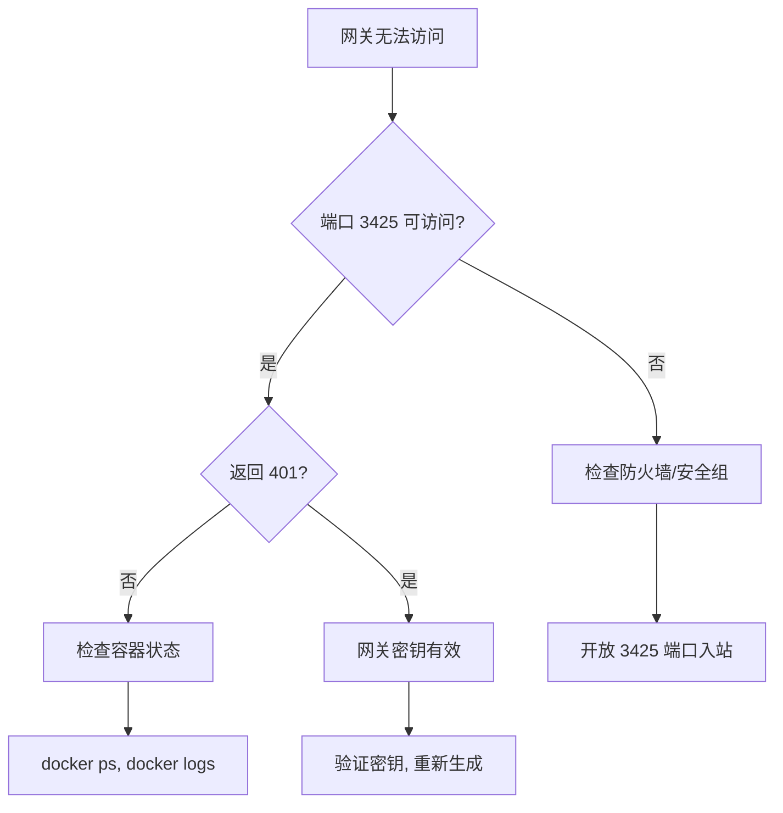

# magpie 故障排查指南

## 快速诊断流程



## 常见问题

### 1. 网关无法访问（HTTP 000 或连接超时）

**症状**：

```bash
curl http://你的服务器IP:3425/v1/models
# 返回 000 或超时
```

**可能原因**：

1. 容器未运行
2. 端口未绑定
3. 防火墙/安全组拦截
4. 网络问题

**解决步骤**：

1. 检查容器状态：

   ```bash
   docker ps --filter name=magpie
   ```

2. 检查端口绑定：

   ```bash
   docker port magpie 3425
   # 应显示 0.0.0.0:3425
   ```

3. 本地测试：

   ```bash
   # 在服务器上测试
   curl http://127.0.0.1:3425/v1/models
   # 应返回 401（未带密钥）
   ```

4. 检查防火墙：
   ```bash
   # 查看 iptables 规则
   sudo iptables -L -n | grep 3425

   # 检查云安全组（AWS/Aliyun/Oracle Cloud）
   # 需登录控制台确认
   ```

### 2. 网关返回 401（认证失败）

**症状**：

```bash
curl -H "Authorization: Bearer wrong-key" \
  http://你的服务器IP:3425/v1/models
# 返回 {"error": "Unauthorized"}
```

**解决步骤**：

1. 验证网关密钥：

   ```bash
   # 查看现有密钥
   docker exec magpie magpie gateway-key list
   ```

2. 重新生成密钥：

   ```bash
   # 生成新密钥
   NEW_KEY=$(openssl rand -hex 32)
   docker exec magpie magpie gateway-key add "New-Key" --key "$NEW_KEY"
   ```

3. 测试新密钥：
   ```bash
   curl -H "Authorization: Bearer $NEW_KEY" \
     http://127.0.0.1:3425/v1/models
   ```

### 3. Web UI 无法访问

**症状**：

- 浏览器显示 "This link's key is not this magpie web's"
- 连接被拒绝

**解决步骤**：

1. 获取正确 Web 密钥：

   ```bash
   docker logs --tail 5 magpie | grep -o "k=[^ ]*"
   ```

2. 检查隧道连接：

   ```bash
   # 验证隧道是否建立
   netstat -an | grep 3430
   # 应有 LISTEN 状态
   ```

3. 重启隧道：
   ```bash
   # 停止现有隧道
   pkill -f "ssh.*3430"

   # 重新建立
   ssh -N -L 3430:127.0.0.1:3430 你的服务器 &
   ```

### 4. 模型列表为空

**症状**：

```bash
curl -H "Authorization: Bearer key" \
  http://服务器:3425/v1/models
# 返回 {"data": []}
```

**解决步骤**：

1. 检查提供商状态：

   ```bash
   docker exec magpie magpie providers
   # 查看是否有启用(●)的提供商
   ```

2. 添加提供商：

   ```bash
   docker exec magpie magpie provider add deepseek sk-你的密钥
   ```

3. 刷新模型目录：
   ```bash
   # 查看刷新日志
   docker logs magpie | grep -i "model.*refresh"
   ```

### 5. 容器启动失败

**症状**：

```bash
docker ps --filter name=magpie
# 状态为 Exited 或 Restarting
```

**解决步骤**：

1. 查看错误日志：

   ```bash
   docker logs magpie
   ```

2. 常见错误：
   - **端口冲突**：3425 已被占用
   - **权限问题**：/config 目录权限错误
   - **镜像问题**：无法拉取 ghcr.io

3. 重新部署：
   ```bash
   # 备份配置卷
   docker volume inspect magpie-config

   # 清理并重试
   docker rm -f magpie
   # 重新运行 deploy-magpie.sh
   ```

### 6. 性能问题（响应慢）

**症状**：

- API 响应时间 > 1s
- 高 CPU/内存使用

**解决步骤**：

1. 监控资源：

   ```bash
   docker stats magpie
   ```

2. 检查网络延迟：

   ```bash
   # 测试网关响应时间
   time curl -s -o /dev/null \
     -H "Authorization: Bearer key" \
     http://127.0.0.1:3425/v1/models
   ```

3. 优化建议：
   - 减少不必要的提供商
   - 启用缓存（如果支持）
   - 调整路由规则复杂度

### 7. 备份/恢复失败

**症状**：

```bash
docker exec -it magpie magpie backup sync
# 提示密码错误或网络问题
```

**解决步骤**：

1. 检查备份配置：

   ```bash
   # 查看环境变量
   docker inspect magpie --format='{{json .Config.Env}}' | jq .
   ```

2. 手动备份：

   ```bash
   # 备份配置卷
   docker run --rm -v magpie-config:/config -v $(pwd):/backup alpine \
     tar czf /backup/magpie-config-$(date +%Y%m%d).tar.gz -C /config .
   ```

3. 手动恢复：
   ```bash
   # 停止容器
   docker stop magpie

   # 恢复配置卷
   docker run --rm -v magpie-config:/config -v $(pwd):/backup alpine \
     tar xzf /backup/magpie-config-最新.tar.gz -C /config

   # 启动容器
   docker start magpie
   ```

## 日志分析

### 关键日志模式

```bash
# 查看完整日志
docker logs --tail 100 magpie

# 过滤错误
docker logs magpie | grep -E "(error|fatal|panic)" -A2 -B2

# 查看启动过程
docker logs magpie | grep -E "(start|listen|ready)" -i

# 查看账号刷新
docker logs magpie | grep -E "(account|credential|refresh)" -i

# 查看路由决策
docker logs magpie | grep -E "(route|select|model)" -i
```

### 日志级别

magpie 支持日志级别调整（如果版本支持）：

```bash
# 启动时设置
-e MAGPIE_LOG_LEVEL=debug
```

## 网络诊断

### 端口测试

```bash
# 在服务器本地测试
curl -v http://127.0.0.1:3425/v1/models

# 从外部测试
curl -v http://服务器IP:3425/v1/models

# 检查端口监听
ss -tlnp | grep 3425
```

### 防火墙检查

```bash
# Linux 防火墙
sudo ufw status
sudo iptables -L -n

# 云服务商安全组
# AWS: 检查 Security Group
# Aliyun: 检查安全组规则
# Oracle Cloud: 检查 VCN Security List
```

## 数据库问题

### 配置损坏

症状：提供商丢失、路由组异常

修复：

```bash
# 从备份恢复
docker exec -it magpie magpie backup restore

# 或手动修复（进入容器）
docker exec -it magpie sh
cd /config/magpie
# 检查 providers/, groups/, keys/ 目录
```

### 权限问题

症状：无法写入配置

修复：

```bash
# 检查卷权限
docker volume inspect magpie-config

# 重置权限（谨慎操作）
docker run --rm -v magpie-config:/config alpine \
  chown -R 65532:65532 /config
```

## 联系支持

### 内部支持

- **负责人**: 06_00（集团技术部主管）
- **文档**: [magpie-config-guide.md](./magpie-config-guide.md)
- **脚本**: [deploy-magpie.sh](../scripts/deploy-magpie.sh)

### 外部资源

- **官方文档**: https://usemagpie.ai/docs
- **GitHub**: https://github.com/yetone/magpie
- **Discord**: magpie 官方社区

### 紧急恢复

如果所有方法失败，执行完全重置：

```bash
# 1. 备份现有配置
docker volume inspect magpie-config > magpie-backup-$(date +%Y%m%d).json

# 2. 停止并清理
docker rm -f magpie
docker volume rm magpie-config

# 3. 重新部署
./deploy-magpie.sh 你的服务器IP
```

---

_本指南基于实际运维经验编写，会持续更新。遇到新问题请记录并补充到此文档。_
